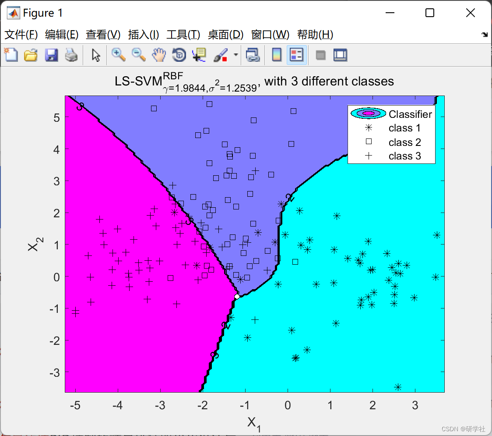
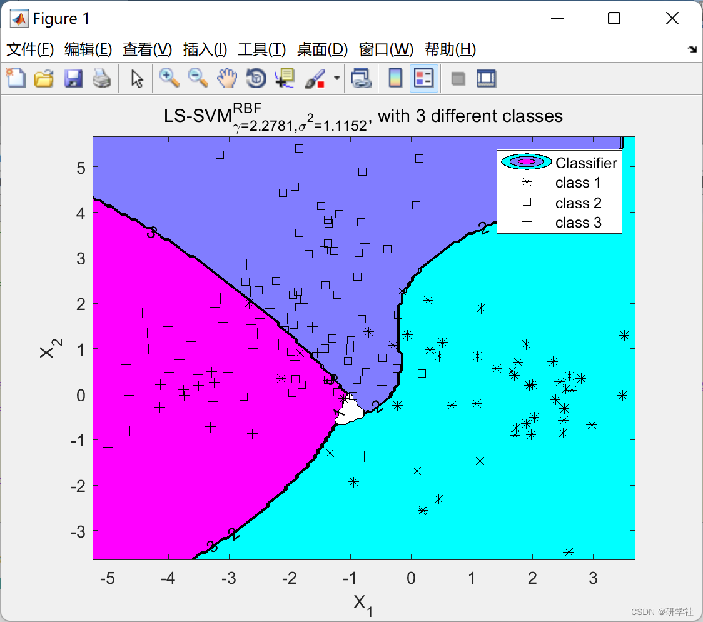
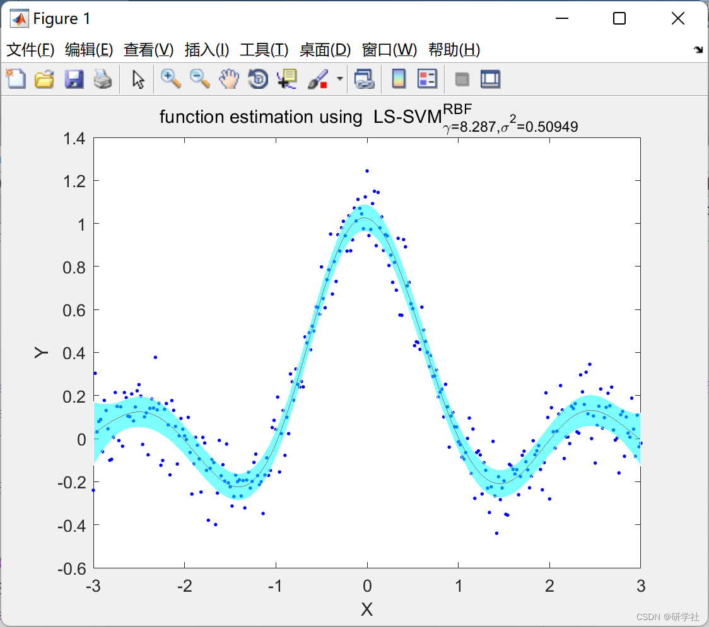
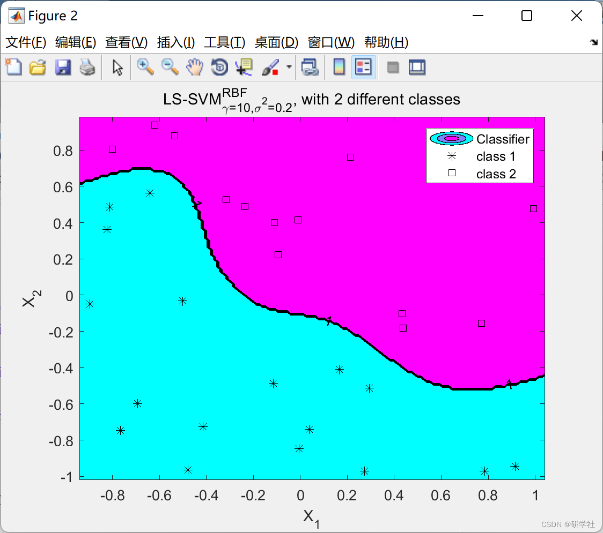
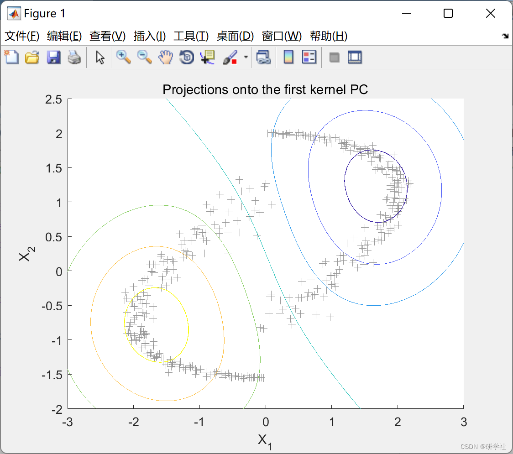
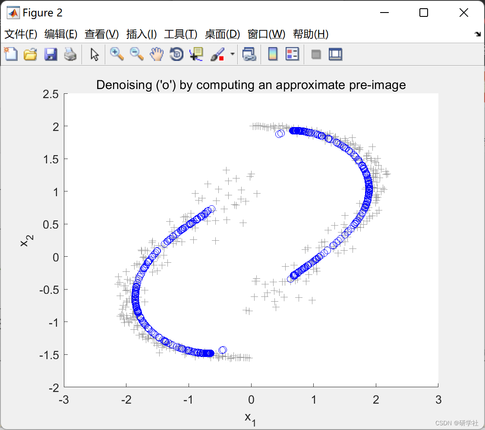
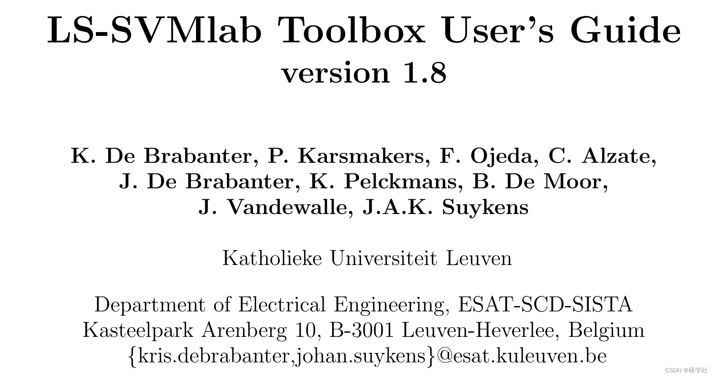

# Research on classification, regression, time series prediction and unsupervised learning based on LS-SVM dual problem (Matlab code implementation)

💥💥💞💞 Welcome to this blog❤️❤️💥💥
🏆 Bloggers' Advantages: 🌞🌞🌞 The content of the blog strives for rigorous thinking and clear logic to facilitate readers.
⛳️ Mantra: A journey of a thousand miles is begun with a single step. 1 Overview📚2 Run Results🎉3 References🌈4 MATLAB Code Implementation
💥1 Overview Support Vector Machines (SVM) are a powerful method for solving nonlinear classification, function estimation, and density estimation problems, leading to many recent developments in kernel-based learning methods. SVM was introduced in the context of statistical learning theory and structural risk minimization. In these methods, one addresses convex optimization problems, typically quadratic programming. Minimal Quadratic Support Vector Machine (LS-SVM) is a reformatted version of standard SVM[32, 43] that can solve linear KKT systems. LS-SVM is closely related to regularized networks [10] and Gaussian processes [51], but it also emphasizes and utilizes the original dual interpretation.
Classical pattern recognition algorithms (such as kernel Fisher discriminant analysis) have links to unsupervised learning, recursive networks, and extensions of control[33]. When necessary, robustness, sparsity, and weight enforcement can be added to LS-SVM, and a Bayesian framework with three inference levels has been developed[44]. Similar original dual formulations are given for kernel PCA, kernel CCA, and kernel PLS.
For very large scale problems and online learning, a fixed-size LS-SVM method based on Nyström approximation is proposed[8], which actively selects support vectors and estimates in the original space. Methods with original dual representations have also been developed for kernel spectral clustering[2], data visualization[39], dimensionality reduction, and survival analysis[40]. The current LS-SVMlab toolbox includes implementations of many LS-SVM algorithms related to classification, regression, time series prediction, and unsupervised learning in Matlab.
📚2 Run Results
​Edit
​Edit
​Edit
​Edit
​Edit
​Edit
Part of the code:
% Initialize values
type = 'classification';
gamma = 0.1;
kernel = 'RBF_kernel';
sigma2 = 1;
sigma2ent = 0.1;
crit_old = -inf;
Nc = 20;
Xs = X(1:Nc,:);
Ys = Y(1:Nc,:);
%
% Initiate grid for plot
grain = 25;
xmin1 = min(X(:,1));
xmax1 = max(X(:,1));
xmin2 = min(X(:,2));
xmax2 = max(X(:,2));
xrange1 = xmin1:(xmax1-xmin1)/grain:xmax1;
xrange2 = xmin2:(xmax2-xmin2)/grain:xmax2;
[XX,YY] = meshgrid(xrange1,xrange2);
Xt = [reshape(XX,numel(XX),1) reshape(YY,numel(YY),1)];
figure;
%
% iterate over data
%
for tel=1:5*length(X)
%
% new candidate set
%
Xsp=Xs; Ysp=Ys;
S=ceil(length(X)*rand(1));
Sc=ceil(Nc*rand(1));
Xs(Sc,:) = X(S,:);
Ys(Sc,:) = Y(S);  
Ncc=Nc;  
%  
% automaticly extract features and compute entropy  
%  
crit = kentropy(Xs,kernel, sigma2ent);  
if crit <= crit_old,  
crit = crit_old;  
Xs=Xsp;  
Ys=Ysp;  
else  
crit_old = crit;  
%  
% ridge regression  
features = AFEm(Xs,kernel, sigma2,X);  
features_t = AFEm(Xs,kernel, sigma2,Xt);  
[w,b,Yht] = ridgeregress(features,Y,gamma,features_t);  
Yht = sign(Yht);  
%  
% make-a-plot  
Ygt = reshape(Yht(:,1),size(XX,1),size(XX,2));  
colormap cool;  
[C,h]=contourf(XX,YY,Ygt);  
hold on;  
n = find(Y<=0);  
np = plot(X(n,1),X(n,2),'k.');  
p = find(Y>0);  
pp = plot(X(p,1),X(p,2),'k+');  
sv = plot(Xs(:,1),Xs(:,2),'go','Linewidth',7);  
xlabel('X_1'); ylabel('X_2');  
title(['Approximation by fixed size LS-SVM based on maximal entropy: ' num2str(crit)]);  
legend([np pp sv],'Negative points','Positive points',...  
'Support Vectors');  
hold off; drawnow  
end  
end  
🎉3 References Editing
🌈4 Matlab code implementation

## Images

<!-- PAYMENT_BLOCK -->

## Get this dataset

- Payment link (Stripe): [Buy now](https://buy.stripe.com/3cs8yP7sY87d0vu9AB)
- Payment QR code: 

<!-- /PAYMENT_BLOCK -->
